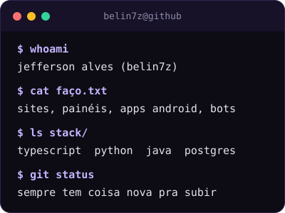
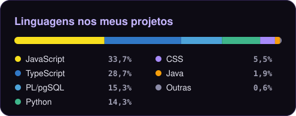
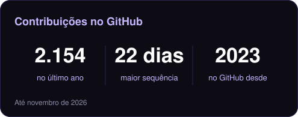

  

 

### Fala! Eu sou Jefferson 👋

🇧🇷 Brasil · 💜 Programo por hobby

Pego um projeto, termino ele e saio sabendo mais do que quando comecei.

O que começou pequeno hoje virou loja online, painel de gestão, app Android e bot de Discord, quase sempre com dados em tempo real e cuidando de tudo, do banco até a tela.

 

---

## 🧩 O que eu construo

<table>
  <tr>
    <td width="50%" valign="top">
      <h3>🛒 Lojas online</h3>
      Catálogo, carrinho, pedidos e aparência que muda em poucos cliques.
    </td>
    <td width="50%" valign="top">
      <h3>📊 Painéis de gestão</h3>
      Estoque, pedidos, clientes e operação atualizando ao vivo.
    </td>
  </tr>
  <tr>
    <td width="50%" valign="top">
      <h3>📱 Apps Android</h3>
      Aviso no celular, localização em tempo real e APK gerado automático.
    </td>
    <td width="50%" valign="top">
      <h3>🤖 Bots de Discord</h3>
      Comunidade, música e automação, em Python e JavaScript.
    </td>
  </tr>
</table>

---

## 🚀 Tecnologias

### 🎨 Frontend

### ⚙️ Backend e bots

### 🗄️ Banco de dados

### 📱 Mobile

### ☁️ Nuvem e ferramentas

---

## 📊 Números

  
  

---

## 🎯 No que estou mexendo agora

---

## 📫 Bora trocar ideia?

